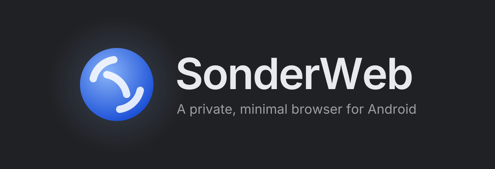

<p align="center">
  
</p>

<p align="center">
  <a href="https://github.com/Verisonder/SonderWeb/releases"></a>
  
  
  
  <a href="LICENSE"></a>
</p>

<p align="center">
  <b>A private, minimal web browser for Android.</b><br>
  Firefox's engine underneath, uBlock Origin built in, the whole screen for the page. No account, no telemetry.
</p>

<p align="center">
  <a href="https://github.com/Verisonder/SonderWeb/releases"><b>⬇ Download the APK</b></a>
</p>

---

## What it is

SonderWeb is a calm, quiet browser in the spirit of Helium on the desktop: almost no interface, the page edge to edge, and privacy switched on from the first launch. It's built on GeckoView, the engine of Firefox for Android, so add-ons from addons.mozilla.org work too.

Nothing is sent to any SonderWeb server, because there isn't one.

## Features

| | |
|---|---|
| **uBlock Origin, built in** | Ads, trackers and malware blocked from the first page. Tap the shield in the bar for the count, the element picker or to switch it off for a site. |
| **Other extensions** | Add more from addons.mozilla.org: ⋮ › Extensions › Get more extensions. |
| **Hardened engine** | Strict tracking protection, fingerprinting protection, cookies kept apart per site and trackers' cookies purged, bounce-tracking protection, tracking parameters stripped from links, HTTPS only, sites kept from probing your home network, Global Privacy Control. |
| **Really private tabs** | Pure black and kept apart from your history, bookmarks and shortcuts. Locked behind your fingerprint every time you go in, no screenshots, no tab previews, incognito keyboard, encrypted DNS (Quad9), nothing kept once closed. |
| **The page gets the screen** | The bar floats, then shrinks into a small round button as you scroll, or slides away. Swipe the bar sideways to put it away, long-press the button to tuck it out of sight. The status bar is hidden unless you want it. |
| **Quick gestures** | Hold the tabs button and slide up for a new tab. Hold the address and slide onto any open tab to switch. Pull down at the top of a page to reload. |
| **A start page** | The time, a greeting, the weather (Open-Meteo; only the place you pick is sent) and the shortcuts you add. Star a site in the menu to pin it there. |
| **!bangs and your search engine** | `!w Tangier`, `!yt lofi`, `!gh sonder` search a site directly. DuckDuckGo by default, restyled to match the browser; Brave, Startpage, Qwant, Ecosia, Kagi, Google, Bing or your own. |
| **Asks before opening apps** | A link an app could open asks first: open the app, or stay in the browser. |
| **Encrypted DNS** | Off by default so a VPN or DNS blocker keeps working; Quad9, Mullvad or Cloudflare when you want it. |
| **Yours to shape** | Light, dark or system theme; bar on top or bottom, floating or docked, at the size you like; the small button in any corner or anywhere you set. |
| **On your phone only** | History, bookmarks and downloads stay on the device. |

## Install

1. Download `SonderWeb-x.y.z.apk` from the [releases](https://github.com/Verisonder/SonderWeb/releases) and open it.
2. Allow installing from your browser or file manager if Android asks.
3. Optional: Settings › Default browser, so links from other apps open in SonderWeb.

Android 8.0 or newer, 64-bit phones.

## How it is built

```
app/src/main/java/com/verisonder/sonderweb/
  browser/   the engine, tabs, extensions, downloads, private-tab locking
  core/      address bar logic, !bangs, search engines (plain Kotlin, tested)
  data/      settings, history and bookmarks (SQLite), weather
  ui/        Jetpack Compose: bar, start page, tabs, menu, settings
app/src/main/assets/extensions/style/   the built-in DuckDuckGo look
```

Kotlin and Jetpack Compose on GeckoView. The build downloads GeckoView from Mozilla's Maven repository and the signed uBlock Origin release named in `gradle/libs.versions.toml`, and ships it as a built-in extension.

### Building

Needs JDK 17 and the Android SDK.

```sh
gradle assembleDebug
```

## Privacy

No account, no analytics, no crash reports, no SonderWeb servers. The only requests SonderWeb makes on its own are the weather for the place you choose (Open-Meteo) and site icons for your shortcuts (from the site itself, or DuckDuckGo's icon service). Everything else is the pages you open.

## Using SonderWeb

You're welcome to use it, change it and share it — just:

- ✅ **Keep the credit** — leave the copyright and `NOTICE` in place
- 🚫 **Don't claim it as your own** — don't pass SonderWeb off as something you created; if you build on it, say it's based on SonderWeb by Verisonder
- 🚫 **Don't imply endorsement** — the SonderWeb name and logo are the author's; name them only to credit the origin

Want to do something beyond that? Just ask first. 🌐

## License

Apache License 2.0 — see [`LICENSE`](LICENSE) and [`NOTICE`](NOTICE).

GeckoView is under the Mozilla Public License 2.0 and uBlock Origin under the GPL-3.0; both are used unmodified. Font: Inter, SIL Open Font License.

<p align="center"><sub>By <a href="https://github.com/Verisonder">Verisonder</a></sub></p>
